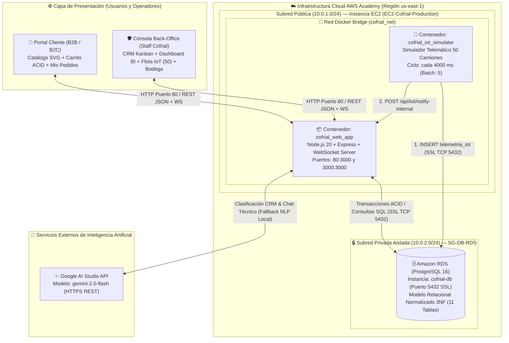

# ❄️ COFRIAL SpA — Plataforma Integral de Cadena de Frío Inteligente y Logística Cloud

> **Transformación Digital Operativa (Hito 2 / Evaluación Sumativa Integral — Nota 3)**  
> **Institución:** INACAP Sede Temuco | **Asignatura:** Transformación Digital (TIEL15)  
> **Autores:** Benjamín Rodríguez – Andrés Díaz  
> **Docente Evaluador:** Felipe Andrés Henríquez Vilugron  

---

## 📋 Índice de Contenidos

1. [Descripción General y Alcance del Sistema](#1-descripción-general-y-alcance-del-sistema)
2. [Arquitectura y Stack Tecnológico (Herramientas Utilizadas)](#2-arquitectura-y-stack-tecnológico-herramientas-utilizadas)
3. [Estructura del Proyecto](#3-estructura-del-proyecto)
4. [Requisitos Previos y Variables de Entorno](#4-requisitos-previos-y-variables-de-entorno)
5. [Guía de Despliegue y Levantamiento (Paso a Paso)](#5-guía-de-despliegue-y-levantamiento-paso-a-paso)
6. [Manual de Uso y Operación de Módulos](#6-manual-de-uso-y-operación-de-módulos)
7. [Comandos de Mantenimiento, Diagnóstico y Verificación](#7-comandos-de-mantenimiento-diagnóstico-y-verificación)

---

## 1. Descripción General y Alcance del Sistema

### 1.1 Propósito de la Plataforma
**Comercializadora y Frigoríficos Araucanía (COFRIAL SpA)** es una plataforma empresarial cloud-native diseñada para erradicar los tres dolores críticos diagnosticados en la operación logística y comercial de distribución refrigerada en la Región de La Araucanía:
1. **Riesgo de infraestructura física local (On-Premises):** Migración total desde un servidor físico vulnerable en bodega hacia una arquitectura de alta disponibilidad en **Amazon Web Services (AWS EC2 + Amazon RDS PostgreSQL 16)** con separación de subredes pública y privada.
2. **Pérdida de trazabilidad en la última milla y mermas por ruptura de frío:** Sustitución del uso informal de mensajería manual (*Shadow IT*) por un ecosistema de **Telemetría IoT contenerizada en Docker** que monitorea en tiempo real una flota de **50 camiones frigoríficos** y emite alertas tempranas ante desviaciones térmicas.
3. **Ausencia de canales digitales y fragmentación comercial:** Implementación de un portal **E-commerce Transaccional B2B/B2C** integrado nativamente con un **CRM Operativo**, un **Asistente Técnico con Inteligencia Artificial (Google Gemini API)** y un **Dashboard de Business Intelligence (BI)** bajo un modelo relacional unificado en **Tercera Forma Normal (3NF)**.

### 1.2 Módulos Principales del Ecosistema

* **🛒 Módulo 1 — E-commerce Transaccional B2B / B2C (`Front-Office` y `Bodega`):**
  * Catálogo dinámico de productos refrigerados y congelados divididos en 3 categorías normativas: *Cárnicos Congelados (-22°C a -12°C)*, *Alimentos Perecibles Refrigerados (0°C a 4°C)* e *Insumos Clínicos Hospitalarios (2°C a 8°C)*.
  * Cada producto cuenta con su **ilustración gráfica vectorial dedicada (`/images/products/<sku>.svg`)**, código SKU, rango térmico exigido por Seremi de Salud y stock en tiempo real en la Bodega Central de Temuco.
  * **Diferenciación tarifaria dinámica:** Conmutación e identificación automática entre perfil **B2B Institucional Mayorista** (Hospitales, Clínicas, Supermercados, con precios preferenciales por volumen y cantidades mínimas de compra) y perfil **B2C Minorista** (consumidor final sin mínimos obligatorios).
  * **Checkout Transaccional ACID:** Confirmación de órdenes de compra mediante transacciones SQL atómicas (`BEGIN` -> `SELECT ... FOR UPDATE` -> descuento de stock -> inserción de `pedido` y `detalle_pedido` -> actualización de etapa en CRM -> `COMMIT` / `ROLLBACK`).
  * **Portal de Trazabilidad del Cliente (*Mis Pedidos & Certificación Térmica*):** Permite a cada cliente auditar en vivo la patente, modelo de camión y temperatura actual de la cámara frigorífica que transporta su pedido, junto con el historial de dictámenes técnicos respondidos por Cofrial SpA.

* **🗂️ Módulo 2 — CRM Operativo Centralizado con Bandeja Inteligente (`Back-Office`):**
  * **Tablero Kanban de 4 Etapas:** Visualización en vivo del ciclo comercial completo:
    1. *Prospectos & Leads*
    2. *Cotizaciones & Negociación*
    3. *Órdenes Confirmadas (Pendientes de Camión)* — incluye botón de asignación directa de unidad frigorífica disponible.
    4. *Despachos en Ruta (Monitoreo IoT)* — cruzado en tiempo real con el estado térmico del camión asignado.
  * **Bandeja Inteligente de Requerimientos y Tickets:** Recepción centralizada de consultas técnicas, cotizaciones por volumen y reclamos de cadena de frío, enriquecidos automáticamente con categoría, nivel de prioridad (`ALTA - B2B`, `CRÍTICA - B2B`, `MEDIA - B2B`, `BAJA - B2C`) y propuesta de dictamen generada por IA para aprobación con un clic por parte del operador de Staff.

* **🤖 Módulo 3 — Asistente Técnico con Inteligencia Artificial (`Google Gemini 2.0 Flash` + `NLP Engine`):**
  * Asistente interactivo integrado en el catálogo para responder consultas sobre normativas térmicas, tarifas mayoristas, tiempos de despacho en La Araucanía y protocolos de cadena de frío.
  * **Arquitectura resiliente de doble capa (Costo Cero):** Consume la API oficial de **Google AI Studio (`gemini-2.0-flash`)** cuando se dispone de `GEMINI_API_KEY`, y cuenta con un **Motor Experto NLP Heurístico** integrado como *fallback* determinístico de latencia cero, garantizando 100% de disponibilidad operativa y sincronización automática de cada consulta con la bandeja del CRM.

* **📊 Módulo 4 — Dashboard de Business Intelligence (`BI Analítico en Vivo`):**
  * Cruza en tiempo real los datos transaccionales de ventas (`pedido`, `detalle_pedido`) con las lecturas telemétricas (`telemetria_iot`, `despacho_ruta`).
  * Muestra 4 KPIs ejecutivos: *Ingresos Totales Confirmados ($ CLP)*, *Órdenes Activas en Ruta*, *Alertas de Ruptura de Frío* y *Valor Económico en Riesgo ($ CLP)*.
  * Incluye **Banner de Alerta Crítica** con identificación de los pedidos e instituciones afectadas, **Gráfico Dual (Chart.js)** de correlación entre ingresos comerciales y desviaciones térmicas, y **Tabla de Auditoría de Impacto Comercial vs Integridad Térmica**.

* **🚛 Módulo 5 — Simulador de Telemetría de Flota IoT (`cofrial_iot_simulator`):**
  * Microservicio contenerizado en Docker que simula la operación continua de los **50 camiones frigoríficos (`CAM-001` a `CAM-050`)** desplazándose por rutas reales de La Araucanía (Temuco, Padre Las Casas, Freire, Villarrica, Lautaro, Victoria, Nueva Imperial, Pitrufquén).
  * Inyecta cada 4 segundos hacia PostgreSQL en Amazon RDS los **5 parámetros exigidos**: `camion_id`, `temp_camara`, `lat`, `long`, `combustible_pct` y `alerta_ruptura_frio`, notificando además al backend mediante HTTP/WebSockets para actualizar los paneles sin recargar la página.

* **🔐 Módulo Transversal — Control de Acceso Basado en Roles (`RBAC`):**
  * Segregación operativa entre **Front-Office (`CLIENT`)** — con acceso exclusivo al Catálogo Refrigerado, Carrito, Asistente IA y Mis Pedidos — y **Back-Office (`STAFF`)** — con acceso administrativo al CRM Operativo, Dashboard BI, Flota IoT de 50 camiones y Panel de Auditoría/Abastecimiento de Bodega Central.

---

## 2. Arquitectura y Stack Tecnológico (Herramientas Utilizadas)

### 2.1 Matriz de Tecnologías y Justificación Técnica

| Capa / Componente | Tecnología / Herramienta | Versión | Rol en el Sistema | Justificación Técnica |
| :--- | :--- | :--- | :--- | :--- |
| **Frontend UI** | HTML5 + Vanilla ES6 + CSS3 | Estándar Web | Single Page Application (SPA) modular sin recarga de página | Cero sobrecarga de compilación, carga instantánea y manipulación directa del DOM con sanitización anti-XSS (`escapeHtml`). |
| **Estilos y Diseño** | Tailwind CSS (CDN) + Inter / JetBrains Mono | v3.x | Sistema de diseño corporativo responsivo | Acabado empresarial de alta legibilidad para paneles de control densos (Kanban, grilla de 50 camiones y tablas ejecutivas). |
| **Visualización BI** | Chart.js + FontAwesome Icons | v4.x / v6.5.1 | Renderizado de gráficos analíticos e iconografía | Permite graficar en doble eje Y la correlación entre ventas en CLP y temperatura promedio en ruta. |
| **Gráfica de Catálogo** | Ilustraciones Vectoriales SVG | SVG 1.1 | Imágenes locales de alta resolución por producto (`public/images/products/`) | Carga instantánea, escalabilidad infinita sin pixelado, cero dependencia de CDNs externos y respaldo automático `onerror`. |
| **Backend / API REST** | Node.js + Express.js | Node 20 Alpine / Express `^4.21.2` | Servidor HTTP, controlador transaccional ACID y ruteo modular | Arquitectura ligera, no bloqueante (I/O asíncrono), ideal para manejar múltiples lecturas de telemetría y transacciones concurrentes. |
| **Tiempo Real** | WebSockets (`ws`) | `^8.18.0` | Canal bidireccional de eventos telemétricos (`TELEMETRY_UPDATE`) | Empuja instantáneamente las alertas de ruptura de frío y nuevas órdenes hacia las pantallas de BI, IoT y CRM. |
| **Seguridad y Red** | `cors` + Rate Limiter + Cabeceras HTTP | `^2.8.5` | Protección de endpoints sensibles (`/api/auth`, `/api/ai`) y cabeceras (`X-Frame-Options`, `nosniff`) | Mitiga ataques de fuerza bruta, abuso de cuota de IA, XSS e inyección SQL (mediante consultas parametrizadas `$1, $2`). |
| **Base de Datos Cloud** | Amazon RDS for PostgreSQL ( + `pg` Pool) | PostgreSQL 16 / `pg ^8.13.1` | Persistencia relacional transaccional en **3NF** con conexión SSL/TLS | Garantiza integridad referencial, bloqueos de fila (`FOR UPDATE`) en el checkout y aislamiento en subred privada de AWS. |
| **Inteligencia Artificial** | Google AI Studio (`gemini-2.0-flash`) + Motor NLP | REST API `v1beta` | Clasificación de tickets CRM y asistente técnico de comercio electrónico | Combina la potencia generativa de Gemini Free-Tier con un clasificador heurístico local que asegura operación continua sin costo. |
| **Simulador IoT** | Node.js (`simulator.js`) / Python (`simulator.py`) | Node 20 / Python 3 (`psycopg2-binary >=2.9.9`) | Inyección continua de telemetría GPS y térmica de 50 camiones | Desacoplado en su propio contenedor Docker; actualiza coordenadas reales en La Araucanía y evalúa umbrales críticos por carga. |
| **Contenedores** | Docker Engine + Docker Compose | Imagen `node:20-alpine` / Compose `3.8` | Empaquetado y orquestación de `cofrial_web_app` y `cofrial_iot_simulator` | Garantiza paridad absoluta entre desarrollo local y producción en EC2, con reinicio automático (`restart: always`) y red bridge aislada. |
| **Infraestructura Cloud** | AWS Academy (Amazon EC2 + Amazon RDS + VPC) | Ubuntu Server 22.04 LTS (`t2.micro` / `t3.micro`) | Cómputo en subred pública (EC2) y datos en subred privada (RDS) | Cumple las mejores prácticas de seguridad cloud: EC2 expone puertos `80`/`3000`/`22`, mientras RDS solo acepta tráfico `TCP 5432` desde el Security Group de EC2. |

---

### 2.2 Diagrama de Arquitectura del Sistema

#### Diagrama de Arquitectura Cloud y Flujo de Datos (Mermaid)



#### Diagrama de Topología en Texto (ASCII)

```text
+---------------------------------------------------------------------------------------------------+
|                             USUARIOS Y OPERADORES (NAVEGADOR WEB)                                 |
|   [Portal Cliente B2B/B2C (Catálogo + Mis Pedidos)]     [Back-Office Staff (CRM + BI + IoT 50)]   |
+-------------------------------------------------+-------------------------------------------------+
                                                  | HTTP (Puerto 80 / 3000) & WebSockets (ws://)
                                                  v
+---------------------------------------------------------------------------------------------------+
| AWS VPC (10.0.0.0/16) - Región us-east-1                                                          |
|                                                                                                   |
|  +---------------------------------------------------------------------------------------------+  |
|  | SUBRED PÚBLICA (10.0.1.0/24) - Amazon EC2 (EC2-Cofrial-Production / Ubuntu 22.04 LTS)       |  |
|  | Security Group (SG-App-EC2): Inbound TCP 22 (SSH), TCP 80 (HTTP), TCP 3000 (App)            |  |
|  |                                                                                             |  |
|  |   +-------------------------------------------------------------------------------------+   |  |
|  |   | Docker Network: cofrial_net (bridge)                                                |   |  |
|  |   |                                                                                     |   |  |
|  |   |  +------------------------------------+     +------------------------------------+  |   |  |
|  |   |  | Contenedor: cofrial_web_app        |     | Contenedor: cofrial_iot_simulator  |  |   |  |
|  |   |  | - Express.js REST API + WebSockets |<----| - Telemetría 50 Camiones (CAM-001  |  |   |  |
|  |   |  | - SPA Frontend + 10 SVGs Productos |     |   a CAM-050) cada 4 seg en ruta    |  |   |  |
|  |   |  | - Motor IA Gemini 2.0 + NLP Local  |     | - Evalúa umbrales (-12°C, 4°C, 6°C)|  |   |  |
|  |   |  +-----------------+------------------+     +-----------------+------------------+  |   |  |
|  |   +--------------------|------------------------------------------|---------------------+   |  |
|  +------------------------|------------------------------------------|-------------------------+  |
|                           | Conexión Cifrada SSL (TCP 5432)          | INSERT telemetria_iot      |
|                           v                                          v                            |
|  +---------------------------------------------------------------------------------------------+  |
|  | SUBRED PRIVADA (10.0.2.0/24) - Amazon RDS PostgreSQL 16 (cofrial-db)                        |  |
|  | Security Group (SG-DB-RDS): Inbound TCP 5432 EXCLUSIVO desde SG-App-EC2                     |  |
|  | Tablas 3NF: tipo_perfil, cliente, requerimiento_crm, categoria_producto, producto,          |  |
|  |             precio_perfil_producto, pedido, detalle_pedido, camion, despacho_ruta,          |  |
|  |             telemetria_iot                                                                  |  |
|  +---------------------------------------------------------------------------------------------+  |
+---------------------------------------------------------------------------------------------------+
```

---

## 3. Estructura del Proyecto

```text
Cofrial-develop/
├── backend/                              # Servidor Backend Node.js + Express y Frontend SPA
│   ├── config/
│   │   └── db.js                         # Pool de conexión SSL a Amazon RDS, migración automática de
│   │                                     # columna imagen_url y motor fallback 3NF en memoria
│   ├── public/                           # Activos estáticos servidos por Express (Frontend SPA)
│   │   ├── css/
│   │   │   └── styles.css                # Paleta corporativa formal, animaciones de pulso e interfaz
│   │   ├── images/
│   │   │   └── products/                 # Ilustraciones SVG dedicadas por SKU (car-001.svg a ins-016.svg + default.svg)
│   │   ├── js/
│   │   │   ├── app.js                    # Controlador principal, autenticación, RBAC (Cliente vs Staff) y WebSockets
│   │   │   ├── ecommerce.js              # Renderizado de catálogo con imágenes, filtros, carrito y checkout ACID
│   │   │   ├── crm.js                    # Tablero Kanban de 4 etapas, asignación de camiones y bandeja de tickets IA
│   │   │   ├── bi.js                     # Dashboard BI, KPIs financieros/térmicos y gráfico dual Chart.js
│   │   │   └── iotView.js                # Monitor en tiempo real de los 50 camiones frigoríficos y simulación de fallas
│   │   └── index.html                    # Estructura HTML5 principal (Navbar RBAC, 5 vistas modulares y 7 modales)
│   ├── routes/                           # Rutas modulares de la API REST
│   │   ├── auth.js                       # Login por RUT/Email, selector rápido de sesión (RBAC) y registro de clientes
│   │   ├── ecommerce.js                  # Catálogo por perfil B2B/B2C, alta de productos, restock y órdenes ACID
│   │   ├── crm.js                        # Pipeline comercial, creación de leads, tickets IA y despacho de camiones
│   │   ├── iot.js                        # Estado de la flota de 50 camiones, inyección de telemetría y simulación de alerta
│   │   ├── bi.js                         # Consultas agregadas SQL (ventas vs alertas de frío y valor en riesgo)
│   │   └── ai.js                         # Endpoint del asistente técnico y clasificador inteligente de requerimientos
│   ├── services/
│   │   └── aiService.js                  # Conector HTTPS a Google Gemini 2.0 Flash + Motor Experto NLP de respaldo
│   ├── Dockerfile                        # Construcción de imagen Docker del servidor web (node:20-alpine)
│   └── package.json                      # Dependencias del backend (express, pg, ws, cors, dotenv)
├── iot-simulator/                        # Microservicio Simulador de Telemetría IoT (Flota 50 Camiones)
│   ├── simulator.js                      # Simulador principal en Node.js con soporte SSL para Amazon RDS
│   ├── simulator.py                      # Implementación alternativa en Python (psycopg2)
│   ├── Dockerfile                        # Construcción de imagen Docker del simulador (node:20-alpine)
│   ├── package.json                      # Dependencias Node.js del simulador (pg, dotenv)
│   └── requirements.txt                  # Dependencias Python alternativas (psycopg2-binary, python-dotenv)
├── database/                             # Scripts SQL del Modelo de Datos Relacional (3NF)
│   ├── BD.sql                            # Esquema DDL completo (11 tablas normalizadas, restricciones CHECK e índices)
│   └── seeds.sql                         # Datos maestros iniciales (perfiles, 9 productos con SVG, 50 camiones, clientes y pedidos)
├── docs/                                 # Documentación Técnica y Académica
│   ├── GUIA_DESPLIEGUE_AWS.md            # Manual detallado de infraestructura VPC, Subredes, Security Groups, EC2 y RDS
│   └── DEFENSA_TECNICA.md                # Pauta maestra paso a paso y argumentario para la defensa técnica
├── docker-compose.yml                    # Orquestador de contenedores (cofrial_web_app + cofrial_iot_simulator)
├── test_all_users_flow.js                # Suite de pruebas automatizadas End-to-End (E2E) para validar todos los flujos
├── .env.example                          # Plantilla documentada de variables de entorno (sin secretos expuestos)
└── README.md                             # Documentación técnica integral del proyecto
```

---

## 4. Requisitos Previos y Variables de Entorno

### 4.1 Herramientas Necesarias

* **Para Ejecución con Contenedores (Recomendado en Local y Producción EC2):**
  * **Docker Engine** (`v20.10+`) y **Docker Compose** (`v1.29+` o `Docker Compose V2`).
* **Para Ejecución Nativa en Entorno Local (Desarrollo):**
  * **Node.js** (`v18.x` o `v20.x LTS`) y **npm** (`v9+`).
  * **PostgreSQL** (`v16`, opcional en local gracias al motor en memoria integrado en `db.js`).
  * **Python** (`v3.10+`, opcional, solo si se desea ejecutar `simulator.py` en lugar de `simulator.js`).
* **Para Administración y Despliegue en Nube (AWS Academy):**
  * **AWS CLI v2** (o Python con `boto3`).
  * Cliente **OpenSSH** (`ssh` y `scp`, preinstalados en Windows 10/11, Linux y macOS).
  * Llave privada del laboratorio (`cofrial-key.pem` o `labsuser.pem`).

### 4.2 Variables de Entorno (`.env`)

El proyecto utiliza un archivo `.env` en la raíz del repositorio. Puede crearse copiando la plantilla sincronizada [.env.example](.env.example):

| Variable | Valor de Ejemplo | Obligatoria | Descripción Técnica |
| :--- | :--- | :---: | :--- |
| `PORT` | `3000` | Sí | Puerto interno en el que escucha el servidor Express (`cofrial_web_app`). En Docker se mapea a `80:3000` y `3000:3000`. |
| `PUBLIC_IP` | `54.147.63.147` | Opcional | Dirección IPv4 elástica o dinámica pública asignada a la instancia EC2 en la sesión activa de AWS Academy. |
| `NODE_ENV` | `production` | Opcional | Define el entorno de ejecución (`development` o `production`). |
| `DB_HOST` | `cofrial-db.xxxx.us-east-1.rds.amazonaws.com` | Sí | Endpoint DNS de la instancia PostgreSQL en Amazon RDS (o `localhost` en entorno local). |
| `DB_PORT` | `5432` | Sí | Puerto estándar de conexión a PostgreSQL. |
| `DB_USER` | `postgres` | Sí | Usuario maestro configurado en la instancia de base de datos Amazon RDS. |
| `DB_PASSWORD` | `tu_password_seguro_aqui` | Sí | Contraseña del usuario maestro de PostgreSQL en Amazon RDS. |
| `DB_NAME` | `cofrial_db` | Sí | Nombre de la base de datos relacional donde residen las 11 tablas en 3NF. |
| `DB_SSL` | `true` | Sí | Habilita el cifrado SSL/TLS requerido para conexiones hacia Amazon RDS (`true` en RDS, `false` en Postgres local sin SSL). |
| `WEB_HOST` | `web` | Opcional | Nombre de host del contenedor backend dentro de la red Docker `cofrial_net` para notificaciones del simulador IoT. |
| `INTERVAL_MS` | `4000` | Opcional | Intervalo en milisegundos entre cada ciclo de inyección telemétrica del contenedor `cofrial_iot_simulator` (4 segundos). |
| `BATCH_SIZE` | `5` | Opcional | Cantidad de camiones actualizados simultáneamente por cada ciclo del simulador IoT. |
| `GEMINI_API_KEY` | `tu_gemini_api_key_aqui` | Opcional | API Key de Google AI Studio para el modelo `gemini-2.0-flash`. Si se omite, opera automáticamente el motor NLP heurístico local. |

---

## 5. Guía de Despliegue y Levantamiento (Paso a Paso)

### 5.1 Ejecución en Entorno Local (Desarrollo)

#### Opción A: Levantamiento Rápido con Docker Compose
```bash
# 1. Clonar el repositorio y entrar al directorio del proyecto
git clone https://github.com/tu-usuario/Cofrial-develop.git
cd Cofrial-develop

# 2. Crear el archivo .env a partir de la plantilla
cp .env.example .env
# (Editar .env con las credenciales de su BD o mantener valores por defecto)

# 3. Construir y levantar los contenedores en segundo plano
docker compose up -d --build

# 4. Verificar que ambos contenedores estén corriendo
docker ps
```
* Abrir en el navegador: **`http://localhost`** (puerto 80) o **`http://localhost:3000`**.

#### Opción B: Ejecución Nativa con Node.js (Sin Docker)
> Si no tienes PostgreSQL corriendo localmente, `backend/config/db.js` activará automáticamente el **Modo Memoria Integrado (3NF)** con todos los productos, imágenes SVG, clientes, pedidos y los 50 camiones precargados.

```bash
# 1. Configurar variables de entorno
cp .env.example .env

# 2. Instalar dependencias y levantar el servidor Backend + Frontend SPA
cd backend
npm install
npm start
```
En una segunda terminal (opcional, si se cuenta con PostgreSQL activo para recibir telemetría continua):
```bash
cd iot-simulator
npm install
npm start
```
* Abrir en el navegador: **`http://localhost:3000`**.

---

### 5.2 Despliegue y Reactivación en Producción (AWS Academy / EC2 + RDS)

Cada vez que se inicia una nueva sesión en **AWS Academy Learner Lab**, las credenciales temporales (`aws_access_key_id`, `aws_secret_access_key`, `aws_session_token`) y la IPv4 pública de la instancia EC2 se renuevan. Sigue este procedimiento exacto para reactivar todo el despliegue en menos de 2 minutos:

#### Paso 1: Configurar Credenciales de AWS CLI
En el panel de AWS Academy Learner Lab, haz clic en **AWS Details** -> **Show** bajo *AWS CLI* y copia el bloque `[default]` en `~/.aws/credentials` (Linux/macOS) o `C:\Users\<USUARIO>\.aws\credentials` (Windows):

```ini
[default]
aws_access_key_id=ASIA...
aws_secret_access_key=...
aws_session_token=IQoJb3JpZ2luX2Vj...
```

Verifica la identidad y conectividad con AWS:
```bash
aws sts get-caller-identity --region us-east-1
```

#### Paso 2: Verificar y Encender Instancias EC2 y RDS
Comprueba el estado de la instancia EC2 (`i-0c13099b0e3e0a684` / `EC2-Cofrial-Production`) y de la base de datos RDS (`cofrial-db`):

```bash
# Consultar estado e IP pública actual de EC2
aws ec2 describe-instances \
  --instance-ids i-0c13099b0e3e0a684 \
  --query "Reservations[*].Instances[*].{ID:InstanceId,State:State.Name,PublicIP:PublicIpAddress}" \
  --output table --region us-east-1

# Consultar estado y Endpoint de Amazon RDS
aws rds describe-db-instances \
  --db-instance-identifier cofrial-db \
  --query "DBInstances[*].{ID:DBInstanceIdentifier,Status:DBInstanceStatus,Endpoint:Endpoint.Address}" \
  --output table --region us-east-1
```

Si alguna se encuentra detenida (`stopped`), enciéndela desde la CLI:
```bash
# Encender instancia EC2 si está stopped
aws ec2 start-instances --instance-ids i-0c13099b0e3e0a684 --region us-east-1

# Encender instancia RDS si está stopped
aws rds start-db-instance --db-instance-identifier cofrial-db --region us-east-1
```

#### Paso 3: Ajustar Permisos de la Llave SSH (`.pem`) y Conectar a EC2
En **Windows (PowerShell)**, restringe los permisos de `cofrial-key.pem` (o `labsuser.pem`) para que OpenSSH permita la autenticación:
```powershell
icacls .\cofrial-key.pem /inheritance:r
icacls .\cofrial-key.pem /grant:r "$($env:USERNAME):(R)"
```
*(En Linux/macOS ejecuta: `chmod 400 cofrial-key.pem`)*.

Conéctate por SSH a la instancia EC2 usando la **nueva IPv4 pública** obtenida en el Paso 2:
```bash
ssh -i cofrial-key.pem ubuntu@<NUEVA_IP_PUBLICA_EC2>
```

#### Paso 4: Actualizar `.env` (Si Cambió algún Endpoint) y Levantar Contenedores Docker
Dentro de la instancia EC2 (`ubuntu@ip-...`):
```bash
cd /home/ubuntu/Cofrial

# Verificar archivo .env (manteniendo intacta GEMINI_API_KEY y DB_HOST de RDS)
cat .env

# Revisar estado actual de los contenedores
sudo docker ps -a

# Levantar o reconstruir los servicios en segundo plano
sudo docker-compose up -d --build
# (Nota: si docker-compose 1.29 muestra KeyError 'ContainerConfig' al recrear web, ejecutar:
#  sudo docker-compose rm -sf web && sudo docker-compose up -d)
```

---

## 6. Manual de Uso y Operación de Módulos

Una vez desplegado el sistema (ej. `http://<IP_PUBLICA_EC2>`), la barra superior permite alternar instantáneamente entre los perfiles de **Cliente (`Front-Office`)** y **Personal Interno (`Back-Office Staff`)** para evaluar todos los flujos de negocio:

### 6.1 Conmutación de Roles y Seguridad RBAC
* En la franja superior de identidad (**Alternar Perfil**):
  * Haz clic en **[Hospital B2B]**, **[Súper B2B]** o **[Minorista B2C]** para operar como **Cliente**. Verás únicamente las pestañas **Catálogo Refrigerado** y **Mis Pedidos & Certificación Térmica**; las vistas internas de CRM, BI y Flota IoT quedan bloqueadas por control de acceso RBAC.
  * Haz clic en **[Operador Staff]** para ingresar al **Back-Office de Cofrial SpA**. Se desbloquean las pestañas **CRM Operativo**, **Dashboard BI**, **Flota IoT (50)** y **Bodega / Stock**.
  * También puedes presionar **[Todos]** para probar el login manual por RUT/Email o **[Registrarse]** para dar de alta un nuevo cliente institucional o particular en Amazon RDS.

### 6.2 Flujo 1: Compra en E-commerce (B2B vs B2C) y Gestión de Bodega
1. En la pestaña **Catálogo Refrigerado**, observa las **9 tarjetas de productos** con sus ilustraciones gráficas dedicadas, rango térmico (`-22°C/-12°C`, `0°C/4°C`, `2°C/8°C`) y stock real en bodega.
2. Utiliza el conmutador **[B2B Mayorista]** / **[B2C Detalle]**:
   * En **B2B**, el *Lomo Vetado Vacuno (`CAR-001`)* tiene tarifa mayorista de **$142.000 / Caja 25kg** con mínimo exigido de **5 cajas**.
   * En **B2C**, el mismo producto cambia automáticamente a tarifa minorista de **$175.000 / Caja 25kg** con mínimo de **1 caja**.
3. Agrega productos al carrito y presiona **[CONFIRMAR ORDEN EN RDS]**:
   * El sistema ejecuta la transacción ACID en PostgreSQL, descuenta el stock de la bodega central y redirige a **Mis Pedidos & Certificación Térmica**.
4. Para reabastecer inventario o crear un nuevo SKU, cambia al perfil **[Operador Staff]** -> pestaña **[Bodega / Stock]** y utiliza los botones **[Ingresar Mercadería (+ Stock)]** o **[Crear Nuevo Producto en Catálogo]**.

### 6.3 Flujo 2: Asistente Técnico con IA y Sincronización con CRM
1. Desde la vista de Cliente en el catálogo, ubica el panel izquierdo **Asistente Técnico (NLP Engine / Gemini)**.
2. Escribe una consulta o reporte crítico, por ejemplo:
   * *"Urgente: el pedido de cárnicos llegó con alerta de ruptura de frío y descongelamiento"* o *"Necesitamos cotizar 40 cajas de lomo vetado con despacho a Temuco"*.
3. Presiona **[Validar con Asistente]**:
   * Recibirás la orientación técnica inmediata y, en segundo plano, el sistema creará automáticamente un ticket clasificado por IA en la tabla `requerimiento_crm` de Amazon RDS.
4. En la pestaña **Mis Pedidos & Certificación Térmica**, al final de la página, el cliente puede revisar el estado de su consulta (*En Mesa Técnica* vs *Aprobado / Respondido*).

### 6.4 Flujo 3: Gestión en CRM Operativo y Despacho de Camiones (`Staff`)
1. Activa el perfil **[Operador Staff]** y abre la pestaña **CRM Operativo**.
2. En el **Tablero Kanban de 4 Etapas**:
   * Revisa la columna **3. Órdenes Confirmadas** (donde aparecerá la orden recién creada en el E-commerce).
   * Haz clic en **[Asignar Camión IoT]**, selecciona una unidad frigorífica disponible (ej. `CAM-008` o `CAM-015`) y presiona **[Despachar en Ruta]**. La orden pasará inmediatamente a la columna **4. En Ruta (Monitoreo IoT)** vinculada a la telemetría en vivo de ese camión.
3. En la **Bandeja de Requerimientos y Clasificación IA** (parte inferior del CRM):
   * Observa los tickets categorizados con prioridad (`CRÍTICA - B2B`, `ALTA - B2B`, etc.) y la respuesta sugerida por IA.
   * Presiona **[Aprobar y Enviar]** para validar el dictamen oficial, el cual quedará inmediatamente visible en el portal del cliente.

### 6.5 Flujo 4: Monitoreo de la Flota IoT (50 Camiones) y Dashboard BI (`Staff`)
1. Abre la pestaña **Flota IoT (50)**:
   * Visualiza la grilla en vivo de las 50 unidades (`CAM-001` a `CAM-050`) con su patente, modelo, temperatura de cámara, barra de porcentaje de combustible, coordenadas GPS en La Araucanía y el badge del pedido asignado (`Ord #1041 · Supermercado Central Freire`).
   * Usa los botones de demostración **[Simular Ruptura de Frío (CAM-014)]** y **[Restaurar Temperatura Normal]** para provocar o revertir en vivo una desviación térmica (+8.5°C) directamente en Amazon RDS.
2. Abre la pestaña **Dashboard BI**:
   * Comprueba cómo se actualizan automáticamente los KPIs de **Alertas de Ruptura de Frío**, el **Valor Económico en Riesgo ($ CLP)** de la mercadería transportada en camiones con alerta, el gráfico comparativo y la tabla de auditoría logística.

---

## 7. Comandos de Mantenimiento, Diagnóstico y Verificación

### 7.1 Verificación de Salud y APIs desde Terminal
```bash
# 1. Verificar estado general del servidor y conexión a Amazon RDS
curl -i http://localhost/api/health

# 2. Verificar catálogo e imágenes SVG de productos (Perfil B2B)
curl -s "http://localhost/api/ecommerce/catalog?perfil=B2B" | head -c 600

# 3. Ejecutar la suite completa de pruebas End-to-End (E2E)
node test_all_users_flow.js
```

### 7.2 Administración de Contenedores Docker en EC2
```bash
# Ver estado de contenedores activos y puertos expuestos
sudo docker ps -a

# Inspeccionar logs en vivo del servidor Web / API y conexión a RDS
sudo docker logs -f --tail 50 cofrial_web_app

# Inspeccionar logs en vivo de la inyección de telemetría IoT (50 camiones)
sudo docker logs -f --tail 50 cofrial_iot_simulator

# Reiniciar ambos contenedores sin perder datos en Amazon RDS
sudo docker-compose restart

# Reconstruir imagen web tras cambios de código y levantar contenedores
sudo docker-compose build web
sudo docker-compose rm -sf web
sudo docker-compose up -d
```

---

## 📚 Documentación Complementaria

* ☁️ **[Guía Paso a Paso de Despliegue en AWS Academy (`docs/GUIA_DESPLIEGUE_AWS.md`)](docs/GUIA_DESPLIEGUE_AWS.md):** Detalle de configuración de VPC, Subredes Pública y Privada, Internet Gateway, Tablas de Ruteo, Security Groups (`SG-App-EC2` y `SG-DB-RDS`), RDS PostgreSQL 16 y EC2.
* 🎤 **[Pauta Maestra y Guion de Defensa Técnica (`docs/DEFENSA_TECNICA.md`)](docs/DEFENSA_TECNICA.md):** Narrativa técnica paso a paso alineada con las 5 dimensiones de la rúbrica oficial y banco de respuestas para preguntas de la comisión evaluadora.

---
**COFRIAL SpA** — *Del Caos Operativo a la Cadena de Frío Inteligente · Región de La Araucanía, Chile (2026)*
